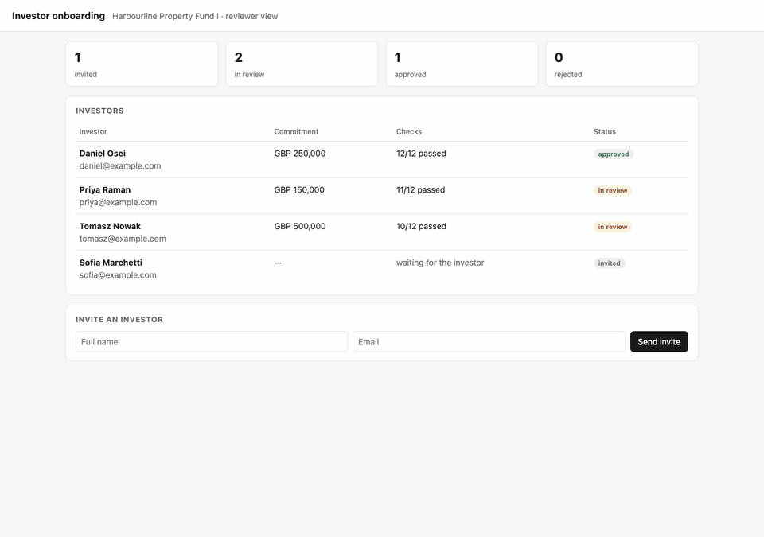

# investor-onboarding

[](https://github.com/joelliewweiyi-del/investor-onboarding/actions/workflows/test.yml)

Onboard investors into a real estate fund. The investor fills in a form and uploads three documents. Automatic checks approve clean applications. Anything that fails goes to a reviewer, with the exact quote behind each check.



Onboarding an investor usually means a person opening every passport, utility bill and subscription agreement, and comparing them with a form by hand. Most applications are clean. This project lets the clean ones through on their own, and shows the reviewer exactly why the rest stopped.

## Flow

```
invite ──▶ form + 3 PDFs ──▶ doc-trace reads each PDF ──▶ 12 checks ──┬─▶ all pass  ─▶ approved automatically
                                                                       └─▶ any fail  ─▶ reviewer queue ─▶ approve / reject with a note
```

Every value the checks use comes from [doc-trace](https://github.com/joelliewweiyi-del/doc-trace), which only accepts a field when it points to its page and quote. A check that needs a field doc-trace could not trace fails. An unreadable document never counts as passed.

## Run it

```sh
npm install
npm start          # http://localhost:3000
```

No API key needed. The app starts with four made-up investors:

| Investor | What happens |
|---|---|
| Daniel Osei | everything matches, approved automatically |
| Priya Raman | utility bill is 160 days old, goes to review |
| Tomasz Nowak | passport expired and agreement unsigned, goes to review |
| Sofia Marchetti | invited, has not submitted yet |

Open Sofia, follow her invite link, click **Use sample documents** and submit. Her application passes all 12 checks and is approved within a second. Or invite someone new and upload your own PDFs.

The sample documents are generated on the fly, dated relative to today, so the demo doesn't go stale.

## The checks

| Document | Check |
|---|---|
| Every document | received, right type, no field contradicts the document |
| Passport or ID card | name matches the form; valid today |
| Proof of address | name matches; address matches; issued in the last 90 days |
| Subscription agreement | investor matches; commitment matches the form; commitment meets the fund minimum; signed and dated by the investor |

The rules live in `src/checks.js`. The fund settings (minimum commitment, maximum age of proof of address) live in `src/fund.js`.

A rejection needs a note for the investor. Only cases in review take a human decision. Every step lands in the case timeline.

## Use an LLM

The offline extractor knows the sample layouts. For real documents set a key, and doc-trace reads them with a model (Grok by default):

```sh
XAI_API_KEY=... npm start
```

See the [doc-trace README](https://github.com/joelliewweiyi-del/doc-trace#use-an-llm) for other providers.

## Tests

```sh
npm test
```

Each failure path has a test: an expired passport, an old or mismatched address, an unsigned agreement, a commitment under the minimum or different from the form, a document for someone else, a missing document and a document in the wrong slot.

## Limits

- State is in memory. Restarting resets the demo.
- No real identity verification (liveness, sanctions or PEP screening). Those need a provider.
- Every name, address and number here is made up.

## License

MIT
